# PM2.5 Forecasting with a Transformer - Group G19

Master 1 Mini Project | Academic Year 2026–2027

## 1. Project Overview

Hi! This is our repository for the PM2.5 forecasting mini-project. Our assigned model for the final phase is the Transformer.

For Milestone 1, our main goal was to build a reliable data pipeline and really understand the dataset before throwing any complex models at it. We didn't want to just write one long, messy script, so we organized the code into separate modules in the `src/` folder. This way, when we start building the Transformer model in the next phase, our data loading and preprocessing steps are already solid and reproducible.

## 2. How to Run

1. Install the packages: `make install` (or `pip install -r requirements.txt`).
2. Run the whole Milestone 1 pipeline: `make run` (or `python scripts/run_eda.py`).

All the outputs (`data/processed/`, `results/`, `figures/`, `folds/`) are created again by step 2.

## 3. The Dataset and What We Found (EDA)

The dataset is the Air Quality – Mediterranean Basin (2016–2026) from Kaggle (file `combined_gee_pm25.csv`). It originally contained 41,718 rows and 15 columns, with one row per station per day (except 2 duplicate rows, see below).

Our exploratory analysis revealed a few things that really shaped how we built the pipeline:

- **Target Cleaning:** We removed 2 duplicate rows (same date and same station). Then we removed 735 rows with invalid PM2.5 values, which are sensor errors (727 rows with PM2.5 <= 0 and 8 with PM2.5 >= 500). After this, we kept 40,981 rows across 91 stations. The raw file has 94 stations: 3 of them disappear because all their rows had an invalid PM2.5.

- **The Skewness Problem:** The PM2.5 distribution is heavily right-skewed. The median is 7.9 µg/m³ and the mean is 9.5, but the max reaches 485. Because of these rare extreme pollution days, we decided to use RobustScaler instead of StandardScaler. It uses the median and interquartile range, so a few extreme days won't ruin the scaling for the Transformer's neural network.

- **Missing Data:** In the raw inputs, only NO2, CO, and O3 have missing values (about 5.9% each). Some of our new features are also empty after a gap in the dates (`pm25_Lag1`, `pm25_RollStd7`, `AOD_Lag1`, `AOD_Change`). We handled all of them with median imputation and a "was missing" indicator, so the pipeline adds 7 indicator columns (16 inputs + 7 indicators = 23 columns for the model).

- **Correlations:** NO2 (Spearman 0.25), AOD (0.18), pressure (0.17), and the east-west wind `wind_u` (-0.16, negative) show the strongest relationships with PM2.5. We also noticed that the link between PM2.5 and AOD changes with the wind (Spearman 0.10–0.12 at low and medium wind, 0.30 at high wind) and, less strongly, with the season (0.16 in spring to 0.25 in winter).

- **Time Series & Stations:** We ran the time-series tests on the daily mean of all stations, over its longest stretch without a gap of more than 3 days (819 days, 2023-03-30 to 2025-06-25). The ADF test confirms the series is stationary (p < 0.001), and the Ljung-Box test shows days are not independent. Also, there are huge differences between stations (Gibraltar has a median of 44 µg/m³ but only 36 rows of data). This is why we prepared both temporal and spatial validation folds for the next milestone (see section 6).

## 4. How the Code is Organized

We split the code into small files so it is easy to reuse later:

- `src/config.py`: Stores all column names, paths, and settings (like the seed 42 and the 80/20 split) so we don't hardcode them everywhere.
- `src/data_loader.py`: Loads the CSV, drops duplicates, and performs the mandatory target cleaning.
- `src/eda.py`: Generates our summary CSVs and all the diagnostic plots.
- `src/features.py`: Contains the time-series feature engineering (lags, rolling stats over 7 days, AOD change, and sin/cos of the day of the year).
- `src/preprocessing.py`: Contains our scikit-learn Pipeline (median imputation, missingness indicators, and RobustScaler). It is only built here; it will be fitted on each training fold later.
- `src/splits.py`: Splits the data chronologically and generates the 3 fold files.
- `scripts/run_eda.py`: The main script that runs everything from start to finish.
- `notebooks/`: Two notebooks (`01_eda.ipynb` and `02_timeseries.ipynb`) where we explored the data step by step before putting the code in `src/`. Note: running them calls the EDA functions again, so they rewrite the files in `results/` and `figures/` (with the same content).

## 5. A Note on Preventing Data Leakage (Section 5.3)

We took data leakage very seriously during this milestone. To predict the PM2.5 of day *t*, we only use the satellite and weather values of day *t* and the PM2.5 values up to day *t-1*. The PM2.5 of day *t* is never an input.

All our imputation and scaling steps are inside a scikit-learn Pipeline. This ensures that later, when we train the model, the scaler will only fit on the training folds and never on the test data.

We also made sure that the 7-day rolling stats use `closed='left'` (no extra `.shift(1)`, which would push the window one more day back). So for day *t* the window covers days *t-7* to *t-1*, and today is never included. Since there are many missing days in the data (only 67% of rows come exactly 1 day after the previous one), the rolling window counts actual days, not rows. For the same reason, the lag features (`pm25_Lag1`, `AOD_Lag1`, `AOD_Change`) are left empty when the previous row of the station is not exactly yesterday. This prevents a situation where "yesterday" is actually a week old. Finally, our train/test split is strictly temporal, keeping the final test period (starting 2024-12-13) completely separate from any validation fold.

## 6. The Validation Folds (Section 5.4)

We prepared three fold files for the next milestone. `folds_temporal.json` uses TimeSeriesSplit with 5 folds and a 1-day gap, which will be our main validation. `folds_spatial.json` uses GroupKFold grouped by station, so we can test on unseen stations. Note: the lag and rolling features of a validation station still use that station's own past PM2.5, so this tests a new station that already has a PM2.5 sensor history, not a place with no sensor at all. `folds_standard.json` is a shuffled KFold that we will only use for comparison.

## 7. Results Summary

After running our pipeline, the following files are generated:

- `results/Exploratory_Data.csv` & `results/Exploratory_temporal.csv`: Statistical summaries and temporal diagnostics.
- `data/processed/processed_data.csv`: The fully cleaned and feature-engineered dataset.
- `data/processed/train_data.csv` & `data/processed/test_data.csv`: The final chronologically split datasets (29,878 rows for train and 10,076 for test). Together they have fewer rows than the 40,981 clean rows, because during feature engineering we drop the rows with no PM2.5 value in the 7 days before (the first days of a station, or the days just after a long gap).
- `folds/`: The three JSON files ready for Milestone 2.

## 8. Visualizations

Here are the diagnostic plots we generated during the EDA:

**1. Target Distribution (Raw vs Log1p)**
Shows the right-skewed nature of PM2.5 and the effect of a log transformation.

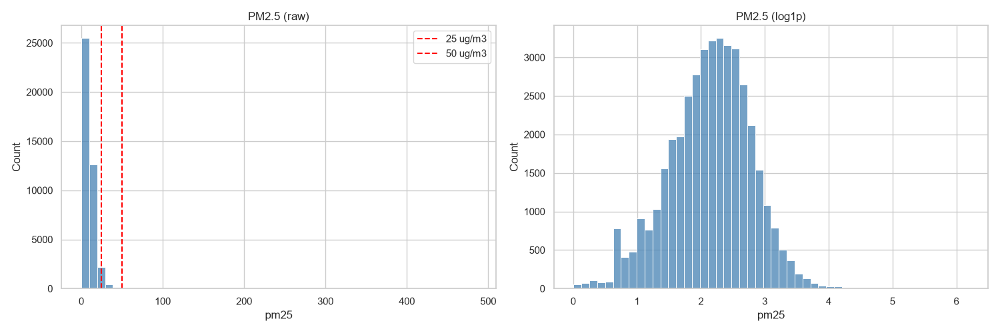

**2. Correlation Matrix**

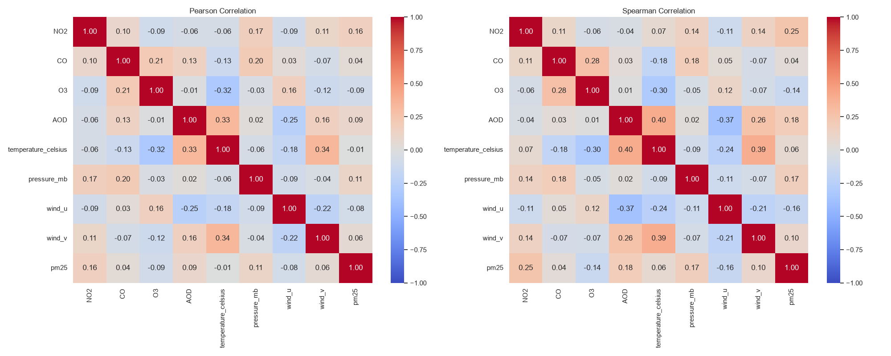

**3. Average Daily PM2.5 Over Time**

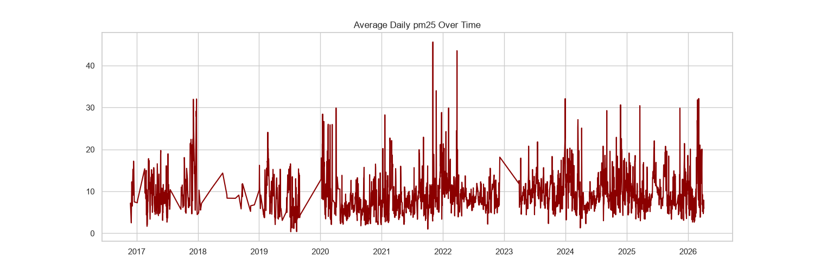

**4. Missing Values Heatmap**

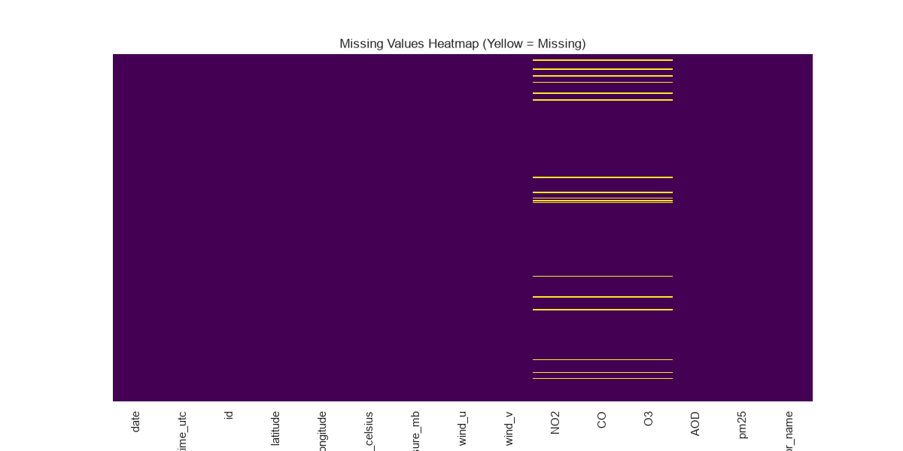

**5. Histograms for ALL Key Variables**

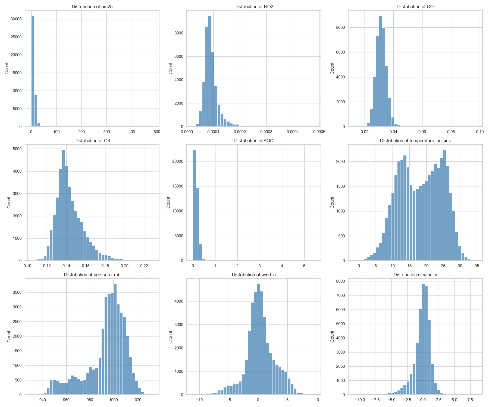

**6. Boxplots for ALL Key Variables (Outlier Detection)**

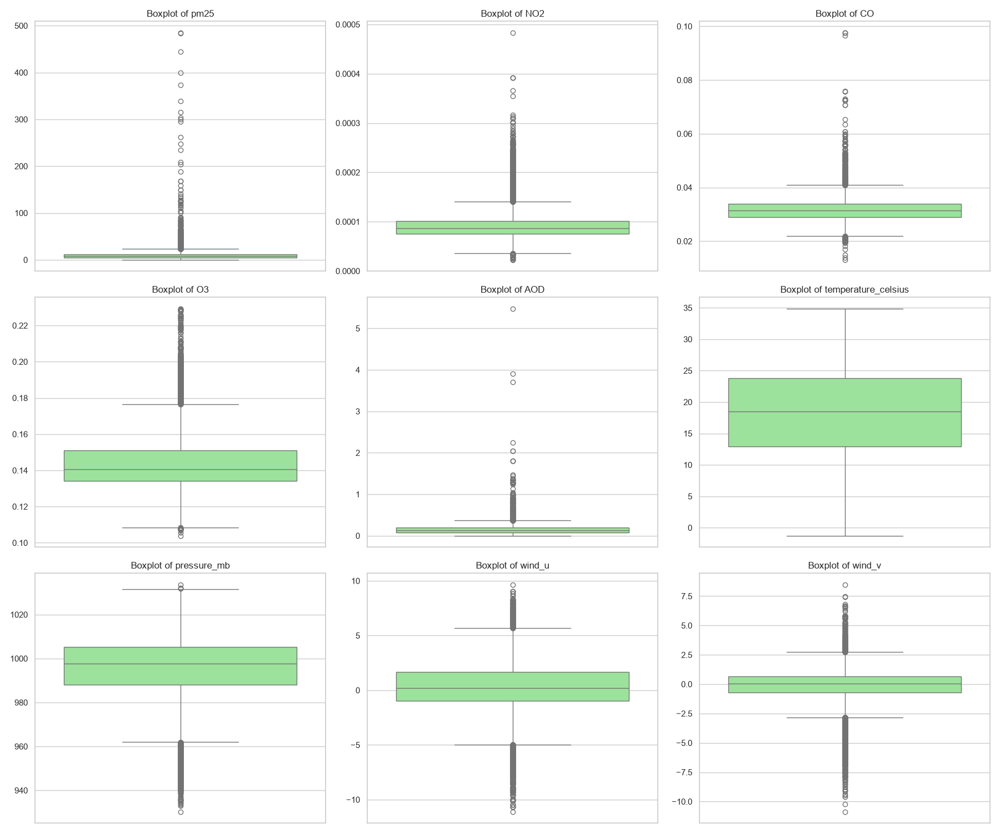

**7. Lead-Lag Relationships with PM2.5**

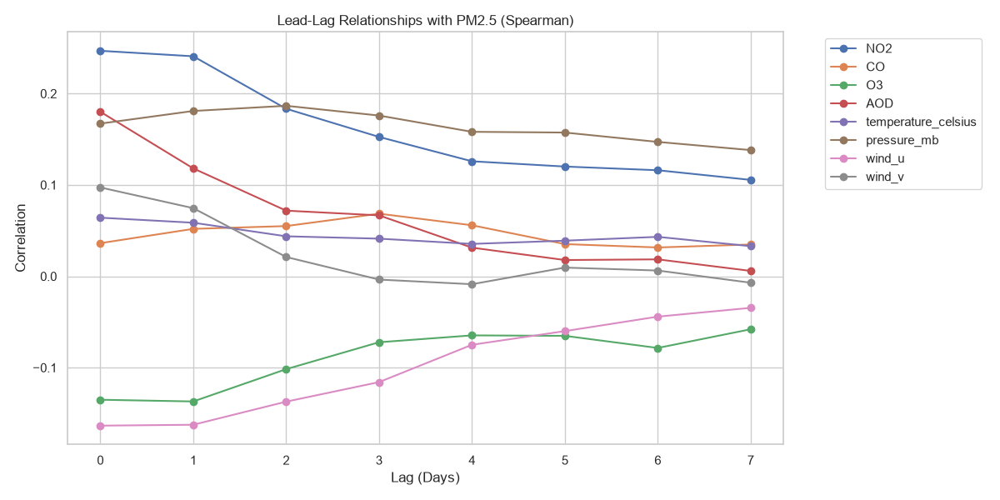

**8. Target Drift by Year**

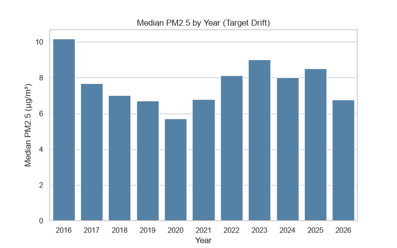

**9. PM2.5 by Month (Seasonal Variation)**

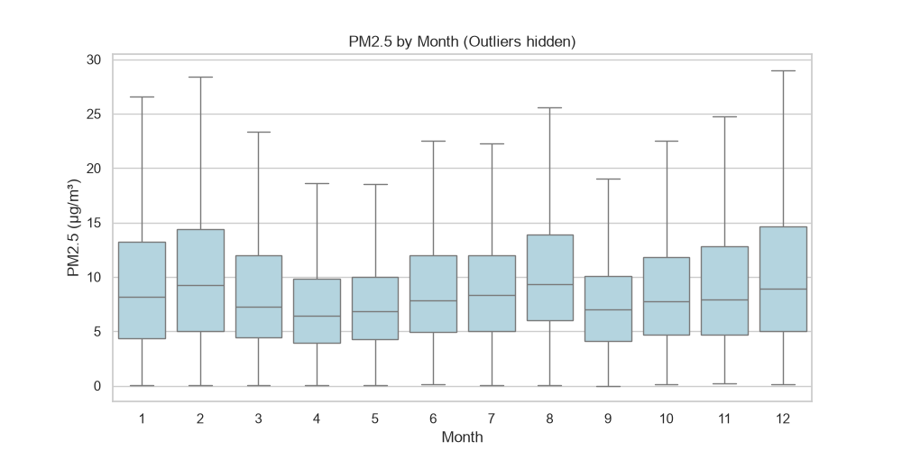

**10. Missing Values by Month**

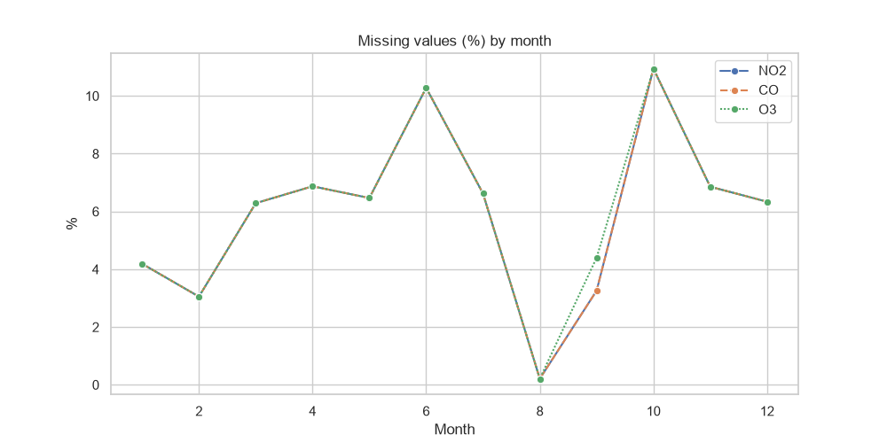

**11. Records per Station**

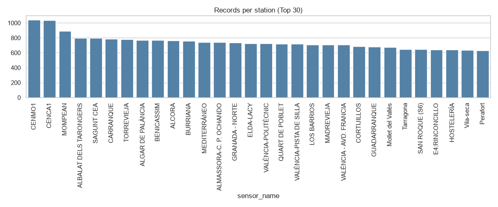

**12. ACF / PACF of PM2.5**

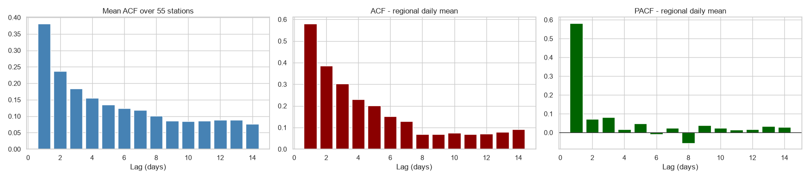

**13. Number of Days Between Two Rows (Timestamp Gaps)**

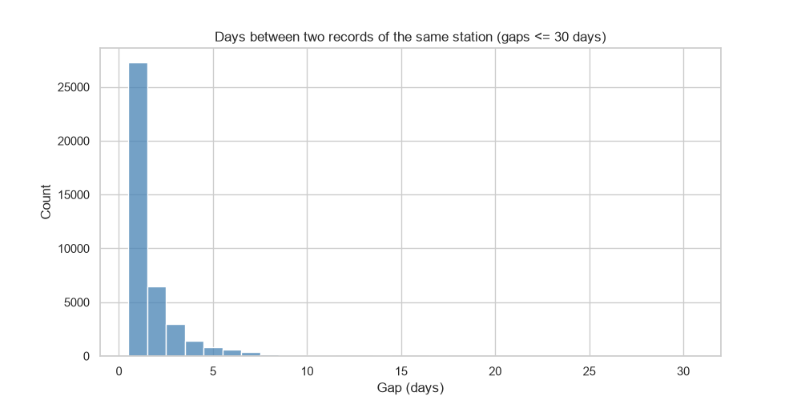

**14. PM2.5 / AOD Correlation by Season and Wind Speed**

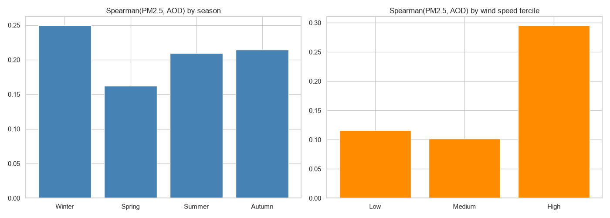

**15. Median of Each Input by Month**

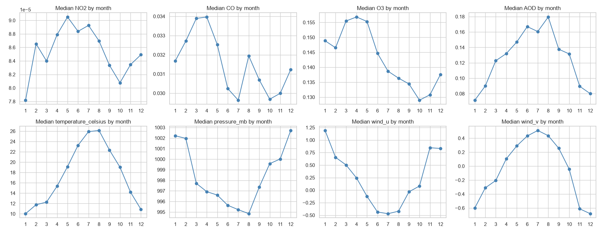

**16. Map of the Stations (color = median PM2.5, size = number of rows)**
Note: we stopped the color scale at the 95th percentile, otherwise Gibraltar makes all other stations look the same.

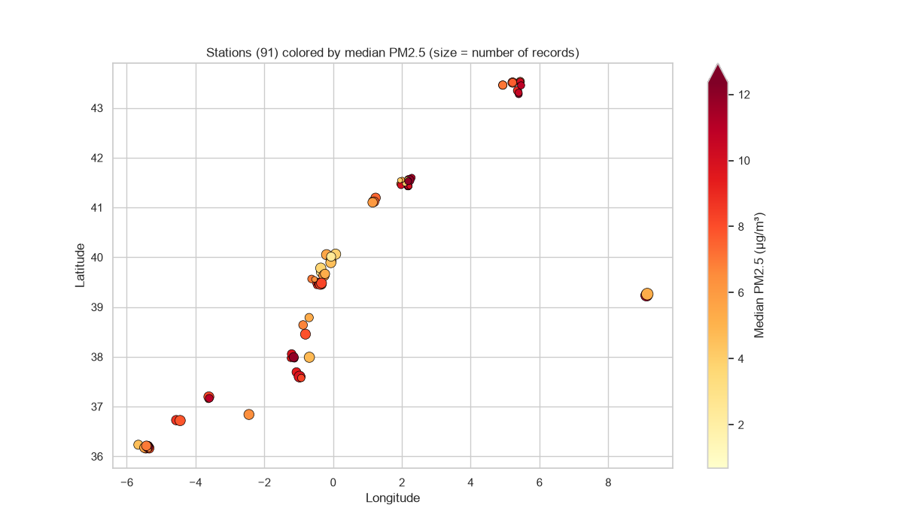

**17. PM2.5 vs AOD**
The points are very spread out, so AOD alone is not enough to predict PM2.5. We need the other inputs too.

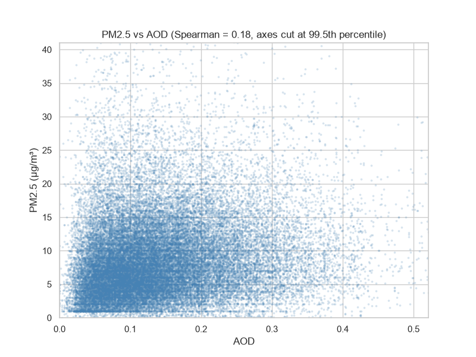

## 9. Next Steps (Milestone 2 - 12 December 2026)

For the next phase, we will reshape the data into sequences for each station (samples, sequence_length, features) to feed into the Transformer. We will train and validate on the saved folds (temporal, spatial, random) using Optuna for hyperparameter search. Finally, we will report RMSE (main metric), MAE, and R² as mean ± std with 95% bootstrap intervals.
